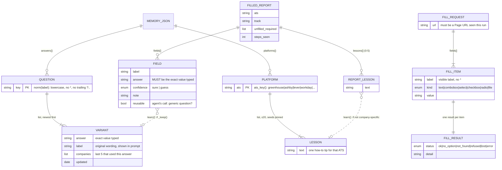

# Data model — memory layer

Two kinds of data: **what is stored** (`memory.json`) and **what flows through** a run
(the agent's `FillRequest` in, `FilledReport` out). The report is the *only* source memory learns from.

## Rules that guard the store

| Rule | Where | Why |
|---|---|---|
| An answer enters memory only if **sure**, **reusable**, ≤200 chars, not a placeholder ("Custom essay…", "(displayed as…)"), doesn't **name the company**, and isn't a resume/CV/cover-letter field | [`memory.py:_keep`](../../memory.py) (line 76) | guesses and company-specific essays must never be replayed |
| Company-name test = whole name, or first word if ≥4 chars, **as a whole word** | `memory.py:_names` (line 67) | "AI Labs" must not block every "Email" |
| Same question, different answer → **new variant**, not overwrite; prompt shows up to 3 with companies | `learn` (line 84), `prompt_section` (line 113) | visa/relocation answers depend on the job's country |
| Lessons: case-insensitive dedup · reject ones naming the company · cap 20 · **evict oldest learned, never a seed** | `learn` | seeds were evicted after one eval before this rule |
| Every write is `tmp → replace` (atomic) | `_save` (line 61) | a crash never leaves half a file |
| Missing / corrupt file → start from `SEED_LESSONS`, empty answers | `load` (line 54) | memory is an optimisation; runs never fail on it |

## Current contents (2026-10-03)
35 questions (35 variants) · greenhouse 15 lessons · ashby 10 lessons.
Inspect what the agent sees: `python3 memory.py`.
