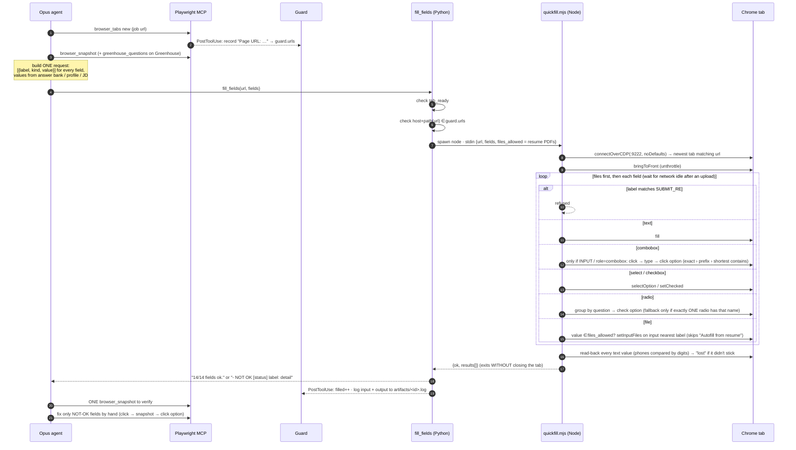

# Flow 2 · fill_fields — a whole page in ONE tool call

Trigger: the agent, after one snapshot · Entry points:
[`apply_agent.py:381`](../../../apply_agent.py) (`fill_fields` tool) →
[`quickfill/quickfill.mjs`](../../../quickfill/quickfill.mjs)

Measured (same 5 jobs, before → after): **195 → 64 turns, $7.82 → $3.13**; Job A 70 → 11 turns.

**Failure modes**
- **No tab matches the url** → `{error, tabs}`; the agent sees open URLs and retries / falls back to manual.
- **Duplicate tabs for one job** → newest wins; `close_stale_tabs` (flow 1) prevents duplicates from re-runs.
- **Node hangs** (page frozen) → 180 s timeout, process killed, agent told to fill the rest by hand.
- **Option not found** → `no_option` + first 20 options listed so the agent can pick the right one manually.
- **Value overwritten by a re-render** (Ashby autofill) → files go first + settle wait; read-back reports `lost`.
- **Yes/No as buttons** (Ashby `aria-pressed` pairs) → `not_found` by design (quickfill never clicks buttons); agent clicks them (+2-4 calls).
- **Tab in background** → `bringToFront`; without it clicks time out (rAF throttling).
- **fill_fields is NOT a Playwright tool**, so the PreToolUse guard doesn't see its internals — safety lives inside quickfill: never clicks buttons/links, never presses Enter, refuses submit-like labels and options, uploads only the resume PDFs passed by Python.
- **Chrome auto-update relaunch** → all tabs gone; re-run the job (~$0.50).
