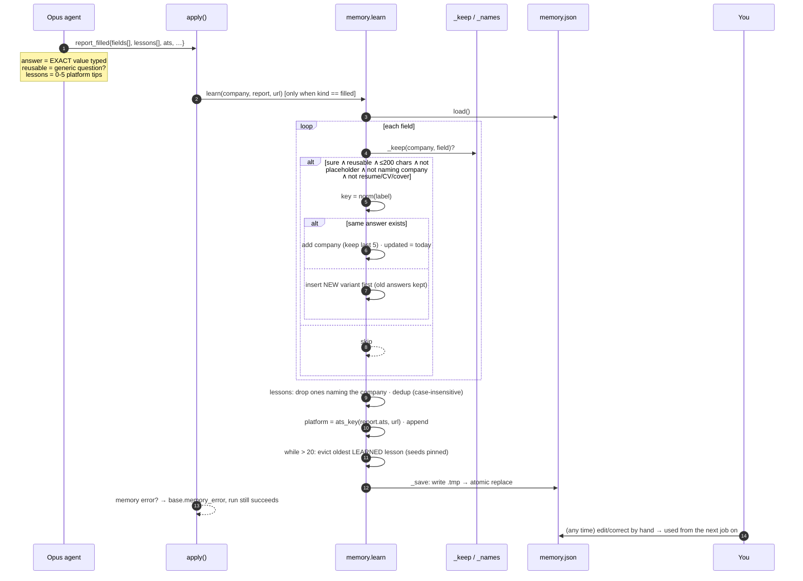

# Flow 3 · Learn — a filled run teaches memory

Trigger: the agent calls `report_filled` · Entry point:
[`apply_agent.py:479`](../../../apply_agent.py) → [`memory.py:84`](../../../memory.py) (`learn`)

Other writers:
- **Seed** (one-off): `python3 memory.py --seed` folds every `ready-to-submit` report in `store.db` through the same `learn()`.
- **You**: edit `memory.json` directly. It is plain JSON; keep the shape in `data-model.md`.

**Failure modes**
- **Learns what the agent typed, before you review.** If you change an answer in the tab before submitting, memory doesn't see it — correct `memory.json` too.
- **Eval runs write to memory** (they call the same `apply()`), so eval results drift as memory grows. Intentional for now; copy `memory.json` aside before an A/B eval.
- **Two separate processes** (e.g. `fill.py` and an eval at once) can lose one's update (last writer wins). Within one process, `learn` is synchronous, so concurrent jobs can't interleave.
- **Agent marks `reusable` wrong** → company-name + placeholder filters catch the common cases; anything else is visible in `python3 memory.py`.
- **Near-duplicate lessons** (same tip, different words) aren't merged — the 20-cap bounds them.
- **No history** (folder isn't a git repo): a bad edit can't be rolled back. `git init` the jobpilot folder (local only) if you want history.
